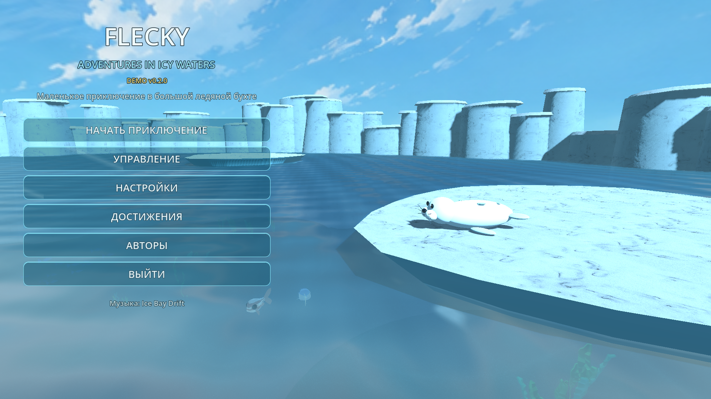
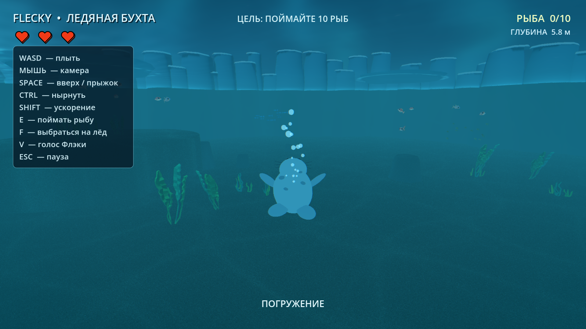
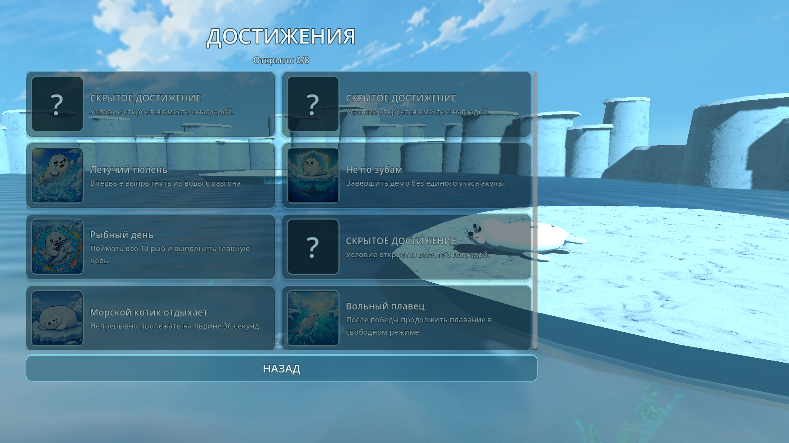

# FLECKY: Adventures in Icy Waters

Небольшая однопользовательская 3D-игра от третьего лица на Godot 4.x.

A small single-player third-person adventure about Flecky, a white seal
exploring an icy bay.

Текущая версия: **Demo v0.2.0**.

## Download / Скачать

[**Download FLECKY Demo v0.2.0 for Windows**](https://github.com/Luisanna20/FLECKY-Adventures-in-Icy-Waters/releases/latest/download/FLECKY_Demo_0.2.0_Windows.zip)

Распакуйте ZIP и запустите `FLECKY.exe`. Установка Godot не требуется.

Extract the ZIP and run `FLECKY.exe`. Godot does not need to be installed.







## Текущий этап: 7 — Флэки и полировка демо

Уже работает:

- процедурная ледяная бухта диаметром около 134 метров;
- глубокая центральная зона, подводные полки и каменные ориентиры;
- пять разнесённых льдин и неровное кольцо ледяных скал;
- по четыре точки выхода на каждой льдине: к безопасному месту больше не нужно подплывать только с одной стороны;
- пять разных неровных контуров льдин и порошистая текстура Snow 02 от Poly Haven (CC0);
- непрерывная внутренняя граница: Флэки больше не может уплыть за карту;
- улучшенная процедурная модель белого тюленя с мордочкой, усами и пятнышками;
- инерционное плавание относительно направления камеры;
- свободное погружение и всплытие с ограничением поверхностью воды;
- короткое выпрыгивание Флэки по дуге при разгоне и удержании `Space`, с плюхом при возвращении;
- ускорение;
- плавная камера со `SpringArm3D`, не проходящая сквозь коллизии;
- живая процедурная анимация корпуса, мягких ласт, хвоста и моргания;
- реакции мордочки на голос, ловлю рыбы и победную сцену;
- прозрачная синеватая поверхность с мягкими волнами Герстнера и пересчитанными нормалями;
- эффект Френеля, экранное преломление, мелкая рябь и блики на гребнях;
- процедурная каустика, закреплённая на подводном дне, полках и камнях;
- плавный холодный подводный оттенок, туман, световые узоры и лёгкое искажение;
- приглушение общего звука под водой;
- четыре чередующихся звука плюха и три пузырьковых звука ловли рыбы
  из CC0-набора rubberduck на OpenGameArt;
- пузырьки при погружении, длинный пенный след, расходящаяся рябь и деформация воды от движения Флэки;
- фирменный голос Флэки по клавише `V`, созданный Катариной в Suno;
- медитативная тема `Ice Bay Drift`, созданная Катариной в Suno, с мягким входом и бесконечным циклом;
- адаптивная громкость музыки под водой, во время тревоги, паузы и победы;
- главное меню на фоне бухты с плавным началом игры;
- стеклянное главное меню и отдельный экран достижений в том же ледяном стиле;
- отдельный экран управления перед стартом;
- выпадающие списки оконного/полноэкранного режима, разрешения и языка с сохранением выбора;
- полная локализация меню, HUD, подсказок и финала на русский, украинский и английский языки;
- три стайки рыб, ограниченные своими зонами;
- спокойное движение рыб и ускоренное бегство от Флэки;
- физические коллайдеры рыб, ограничение водного объёма и обход дна, льдин, скал и подводных полок;
- мягкая зона ловли перед мордочкой по клавише `E`;
- эффект поимки, восстановление рыб и счётчик `0/10`;
- сообщение о выполненной цели после десятой рыбы;
- обозначенные светящиеся зоны выхода на каждой льдине;
- контекстная подсказка возле подходящего края;
- плавный автоматический переход из воды на лёд по клавише `F`;
- состояние отдыха на льдине, безопасное для будущей механики акулы;
- возвращение в воду по повторному нажатию `F`;
- появление акулы после нескольких пойманных рыб или по таймеру;
- предупреждение тенью, плавником, красным пульсом и сообщением;
- обнаружение, погоня, кружение возле льдины и отступление;
- три сердца и 6 секунд временной неуязвимости после укуса;
- повторный укус возможен только после разрыва дистанции с акулой;
- мягкое возвращение на последнюю безопасную льдину после потери сердец;
- настоящая пауза по `Esc` с продолжением, перезапуском и выходом;
- автоматическое завершение после десятой рыбы;
- остановка акулы и возвращение Флэки на ближайшую льдину;
- большая победная рыба и плавный облёт камеры;
- экран `Демо завершено` с повторной игрой и выходом;
- восемь сохраняемых достижений с тематическими иллюстрациями, серыми
  неоткрытыми карточками, секретными условиями и экранными уведомлениями;
- отдельные достижения за пещеру с сокровищем, танец краба, прыжок,
  прохождение без укусов, десять рыб, пять голосов, 30 секунд отдыха
  на льдине и выбор свободного плавания;
- диагностический интерфейс состояния и глубины.

- ясное арктическое небо с солнцем и мягкими облаками;
- отдельное заметное предупреждение об акуле ниже верхней панели интерфейса;
- подсказка после укуса автоматически исчезает по таймеру и сразу очищается при спасении на льдине.
- три анимированных вида рыб Quaternius (тунец, красный луциан и рыба-кардинал) и анимированная акула (CC0), связанные с плаванием, бегством, погоней и укусом.
- четыре лёгкие декоративные стайки из 52 схематичных рыбок: они оживляют дальний план, не входят в группу ловли и не создают физических коллизий;
- доступная подводная пещера в северо-восточной части бухты с неровной каменной аркой, холодным свечением, кристаллами и левитирующим осьминогом Poly by Google (CC BY);
- два анимированных краба Quaternius (CC0), которые ходят боком по длинным маршрутам в разных половинах бухты и не заходят в пещеру;
- 43 куста келпа и морских водорослей в девяти зарослях, на дне, подводных полках и внутри пещеры;
- процедурное покачивание верхушек водорослей течением и холодные изумрудно-бирюзовые вариации.
- каменистая текстура морского дна Low Tide Rocks с трипланарным наложением, шероховатостью и рельефной детализацией;
- отдельная страница `Авторы` в главном меню с идеей, разработкой, моделью Codex и источниками ассетов.
- после финальной сцены можно сразу начать заново, вернуться в главное меню либо остаться в свободном плавании без акулы, ловли и счётчика рыбы.

## Управление

- `WASD` — направление плавания;
- мышь — камера;
- `Space` — всплыть; удерживать с разгона у поверхности, чтобы выпрыгнуть;
- `Ctrl` — погрузиться;
- `Shift` — ускорение;
- `E` — поймать рыбу рядом с мордочкой;
- `F` — выбраться на льдину или вернуться в воду;
- `V` — фирменный голос Флэки;
- `Esc` — пауза.

## Запуск

Самый простой способ:

- `PLAY_FLAKI.cmd` — сразу запустить прототип;
- `OPEN_IN_GODOT.cmd` — открыть проект в редакторе.

Или открыть `project.godot` в Godot 4.x и нажать `F6`/`F5`.

```powershell
Godot.exe --path "F:\FLAKI_Adventures_in_Icy_Waters" --editor
```

## Следующая часть

Оформление окружения и финальная полировка демоверсии перед сборкой под
Windows.
